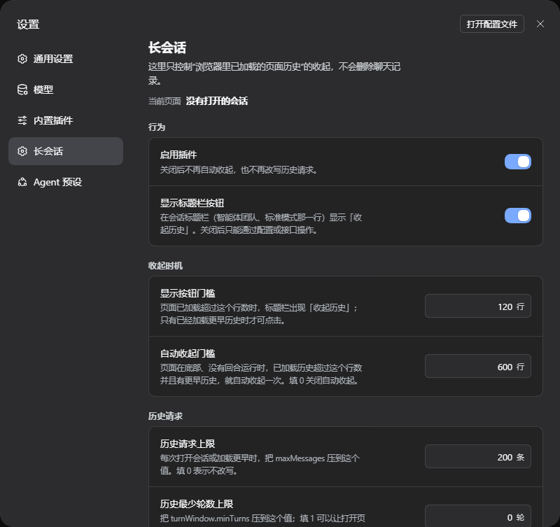

# dsh-longsession

A browser-side plugin for **DeepSeek Harness Desktop / Web** that keeps long chat sessions
from getting slower as the transcript grows.

Repository: <https://github.com/asots/dsh-longsession>

Current release: **0.0.1** (first version).

The host half is an inert Loader row; all behaviour lives in `lib/client.js`. It puts a
“Collapse history” toggle in the session header row and bounds the history already rendered by
the page.

## The measured problem

DSH never unloads history the page has already rendered: live appends plus every “load earlier”
keep accumulating DOM rows. In a 4.4 MB / 11-turn session on a clean test host:

- opening the session: **892 ms** to ready, one batch render, **808 ms max long task**,
  DOM 1,240 → 9,218 nodes, heap 36.6 → 57.6 MB;
- each “load earlier”: one **300–630 ms** main-thread task; rows 368 → 1,330, DOM 9k → 30k,
  heap 58 → 121 MB;
- steady scrolling at 775 rows: 60 fps, zero long tasks — so scrolling/paint is **not** the
  bottleneck, and CSS containment measured neutral.

## What the plugin does

- **Collapse history** — calls the app’s own `SessionFace.resync()` through the `sessions`
  client service. This unloads the history rows the page has already rendered and reopens the
  ordinary opening page (last two turns). Chat records, model context and the disk log are
  **not** deleted.
- **Toggle** — while the page is not collapsed the button reads “Collapse history”. After a
  collapse it reads “History collapsed”; clicking it again restores the window that was loaded
  before collapse. A restore also turns auto-collapse off for that session, so it cannot undo
  what you just restored. The saved window (turn count and scroll offset) is stored per session in
  `sessionStorage`; restoring asks the controller for the missing pages again through
  `loadOlder()`. The button reads “Restoring…” while that runs.
- **Session-header toggle** — registered in the app’s own
  `conversation.session.header.actions` row (next to agent team / mode). It appears once `trimMinRows` rows are loaded, but stays disabled until older history is
  loaded (the opening page has only two turns). A status dot sits before the label: amber = older history is loaded and can be collapsed;
  green = already collapsed; gray = not actionable yet (no older history, a turn is running, or
  restoring). The dot uses high-contrast light/dark colors and follows the app theme. It is a
  host-owned slot, not an overlay.
- **Settings page** — Settings → Long session shows the current page load (rows and approximate
  turns, plus whether it is collapsed) and edits the button threshold, auto-collapse
  threshold, request caps and whether the header toggle is shown.
- **Auto-collapse** — when the reader is at the live tail, no turn is running, older history
  is loaded and the window exceeds `autoTrimRows` rows, it collapses once (15 s cooldown) and
  marks the page collapsed, so it can still be restored.
- **Optional request cap** — lowers `maxMessages` / `turnWindow.minTurns` in the history
  request before it is sent (WebSocket `session/follow` open frame and unary `/api` page RPC).
  Default only caps `maxMessages` at 200; `minTurns` is opt-in.

It never moves, removes, or re-creates transcript nodes; the header toggle is the only DOM it
adds.


*Illustration with demo data — not a real session.*



*Settings → Long session.*

## Install

```sh
dsh plugin --profile <profile> add github:asots/dsh-longsession
```

Use the profile the host actually runs (for example `web`, or the profile a desktop build
uses). Reload the page after installing: the client bundle is loaded per page.

Manual install into a profile:

1. install it as a profile dependency — e.g.
   `dsh plugin --profile <profile> add link:/absolute/path/to/dsh-longsession`, or add
   `"dsh-longsession": "link:..."` to the profile package.json and run `pnpm install` there.
   A bare copy under `node_modules/` is not enough: the desktop plugin manager quarantines
   packages that are not listed as dependencies on its next install.
2. add the Loader row that ships in `cordis.patch.yml` to that profile's `cordis.patch.yml`;
3. reload the page (a host restart is needed only if the profile does not hot-reload patches).

## Configuration

Loader-row config does **not** reach the browser half in this build, so override through
`localStorage["dsh-longsession.config"]` (JSON) or
`window.__DSH_LONGSESSION__.setConfig({...})`, or use Settings → Long session.

| key | default | meaning |
|---|---|---|
| `enabled` | `true` | master switch (disabling stops auto-collapse and wire caps) |
| `trimMinRows` | `120` | row count at which the header toggle appears |
| `autoTrimRows` | `600` | auto-collapse threshold (`0` disables it) |
| `historyMaxMessages` | `200` | cap for history `maxMessages` (`0` = off) |
| `historyMinTurns` | `0` | cap for `turnWindow.minTurns` (`0` = off; `1` halves the opening page) |
| `historyCapsAllSessions` | `false` | apply request caps to subagents/other sessions too |
| `showDock` | `true` | show the header toggle |

## Test

```sh
node test/serve.mjs 17772
```

Open `http://127.0.0.1:17772/harness.html`; the page runs 43 assertions (wire clamp,
collapse/resync, restore via `loadOlder()`, auto-collapse, header and settings slot
registration, subscriber updates, dispose) and prints `ALL PASS`.
`window.__TEST_RESULTS__` is machine-readable.

## Known limits

- Compacting restores the last two turns. A reader deep in old history loses the current
  scroll position; the button is disabled while a turn runs.
- “History collapsed” is not instant: the old pages are re-fetched from the host through
  `loadOlder()`, one page at a time. The saved scroll offset is applied afterwards on a
  best-effort basis; exact pixel restoration is not guaranteed.
- The toggle is visible in long pages but disabled until older history is loaded. A freshly
  opened session is already at the last two turns, so use “load earlier” first.
- Auto-collapse only runs at the live tail; a reader parked above the tail is never surprised.
- An explicit restore turns automatic collapse off for the rest of that session; a new session
  starts with automatic collapse on again.
- Collapsing is per session: only the currently open session has a rendered page history to drop.
- If the `sessions` service is absent, the header toggle stays inert and auto-collapse is
  disabled. If the `slots` service is absent, no toggle renders (the request caps still work).
- `content-visibility` containment was measured neutral for this renderer and is intentionally
  not used.

## License

MIT — see [LICENSE](LICENSE).