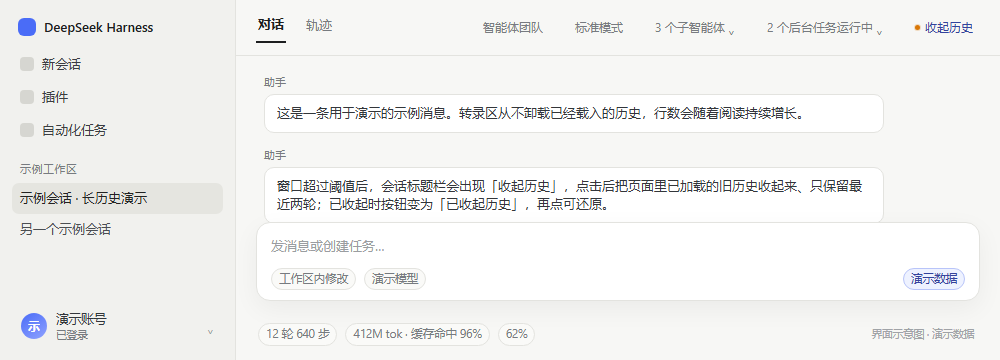
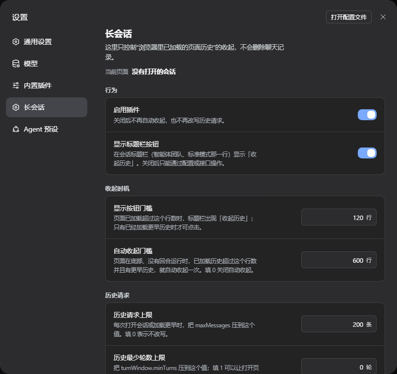

# dsh-longsession

DSH 桌面端 / Web 用久了，长会话会越来越卡。这个插件不碰渲染，只是把**页面里已经加载出来的
历史**收回来，避免对话区无限变大。

仓库：<https://github.com/asots/dsh-longsession>

当前版本：**0.0.1**（第一版）。

宿主半边是一个无行为的 Loader 行；全部行为在 `lib/client.js`：在会话标题栏放一个「收起历史」
开关，并把页面已经渲染的历史控制住。

## 为什么会卡

DSH 不会卸载页面已经渲染过的历史：实时追加和每次点「加载更早」都会一直往页面里加行。我在一个
4.4 MB、11 轮的会话里量过：打开要 892 ms，最长一次长任务 808 ms；点一次「加载更早」是
300–630 ms 的主线程任务，行数从 368 涨到 1,330，DOM 从 9k 涨到 30k，堆从 58 MB 涨到
121 MB。滚动本身是 60 fps，问题不在绘制；`content-visibility` 也试过，没有可测收益。

## 插件做了什么

- **收起历史**：调用 DSH 自己的 `SessionFace.resync()`。子代理换地址时它本来就走这条路：
  把页面已经渲染的历史卸载掉，重新按普通打开页只显示最近两轮。聊天记录、模型上下文、磁盘日志
  都不会删；往上滚点「加载更早」还能重新加载回来。
- **开关状态**：未收起时按钮显示「收起历史」；点击后页面被收起，按钮变成「已收起历史」；再点
  一次会**还原**到收起前加载到的位置。收起前的轮数和滚动位置按会话存在 `sessionStorage`，
  还原时通过 `loadOlder()` 一页页从磁盘重新取回；还原过程中按钮显示「还原中…」。
  还原后本次会话不再自动收起，避免刚还原就被自动收回去。
- **会话标题栏按钮**：注册到 `conversation.session.header.actions`，和智能体团队/模式同一行。
  页面超过 `trimMinRows` 行时就出现；只有已经加载了更早历史（超过打开页的最近两轮）时才可点击。
  按钮前有一个状态圆点：橙黄色表示当前有更早历史、可以收起；绿色表示已收起；灰色表示暂时不可操作
  （没有更早历史、回合运行中或正在还原）。圆点使用高对比度的深色/浅色两套颜色，会跟随应用主题切换。
  它是应用自己的 slot，不是悬浮层，不会盖住左下角账号、输入框或正文。
- **设置页**：设置 → 长会话，显示当前页面加载了多少行、约多少轮、是否已收起，并可调整按钮
  门槛、自动收起门槛、历史请求上限和是否显示标题栏按钮。
- **自动收起**：读者在底部、没有回合在跑、已经加载了更早历史、页面超过 `autoTrimRows` 行时，
  自动收起一次（15 秒冷却），并把页面标记为已收起，所以同样可以还原。
- **可选的请求上限**：把历史请求的 `maxMessages` 默认封顶到 200；`minTurns` 默认不动，
  想更快打开可以设成 1。

它只会多出一个会话标题栏里的开关，不增删、不移动对话节点。



*示意图：使用演示数据，不包含真实会话内容。*



*设置 → 长会话。*

## 安装

```sh
dsh plugin --profile <profile> add github:asots/dsh-longsession
```

`<profile>` 换成宿主实际用的 profile（比如 `web`，或者桌面端用的那个 profile）。装完刷新
页面；客户端 bundle 是按页面加载的。

手动装进某个 profile：

1. 把它作为 profile 的依赖装进去，比如
   `dsh plugin --profile <profile> add link:/仓库绝对路径`；或者在 profile 的 package.json
   里加 `"dsh-longsession": "link:..."`，再在 profile 目录跑 `pnpm install`。
   只把目录拷进 `node_modules/` 不够——桌面端的插件管理器下次安装时会把没写进依赖的包
   挪进 `.ignored`。
2. 把 `cordis.patch.yml` 里那行 Loader 加进该 profile 的 `cordis.patch.yml`；
3. 刷新页面（profile 不热重载 patch 时，需要重启一次宿主）。

## 配置

当前版本的 Loader 行 `config` 不会传到浏览器半边，所以用设置页、或
`localStorage["dsh-longsession.config"]`（JSON）、或
`window.__DSH_LONGSESSION__.setConfig({...})` 覆盖：

| 键 | 默认 | 说明 |
|---|---|---|
| `enabled` | `true` | 总开关，关掉后不再自动收起和改写请求 |
| `trimMinRows` | `120` | 超过多少行时显示「收起历史」按钮 |
| `autoTrimRows` | `600` | 自动收起门槛，`0` 表示关闭 |
| `historyMaxMessages` | `200` | 历史 `maxMessages` 上限，`0` 表示不改 |
| `historyMinTurns` | `0` | `turnWindow.minTurns` 上限，`0` 表示不改；设 `1` 打开页会小一半 |
| `historyCapsAllSessions` | `false` | 是否也改子代理/其他会话的请求上限 |
| `showDock` | `true` | 是否显示会话标题栏按钮 |

## 测试

```sh
node test/serve.mjs 17772
```

打开 `http://127.0.0.1:17772/harness.html`，页面会跑 43 条断言（请求改写、收起与还原、
自动收起、标题栏与设置 slot 注册、订阅、dispose），全过会显示 `ALL PASS`。
`window.__TEST_RESULTS__` 里是结果。

## 已知问题

- 收起只能恢复到最近两轮。如果你正在很旧的历史里翻，收起会丢掉当前位置，得重新点
  「加载更早」；回合运行中按钮不可用。
- 「已收起历史」的还原不是瞬时的：旧页面要通过 `loadOlder()` 从宿主一页页重新取回，取完后
  再按保存的滚动偏移恢复，只能做到尽量接近，不保证像素级一致。
- 刚打开的会话本来就只有最近两轮，没有可收起的更早历史，所以按钮虽然是可见的，但处于
  禁用状态；要先点「加载更早」才能点它。
- 自动收起只在你停在底部时触发，停在旧历史里不会突然动你的页面。
- 历史请求上限默认只作用于当前会话；需要连子代理/其他会话一起改时，勾选「应用到所有会话」。
- 视图缺少 `data-chat-turn` 轮次信息时，按钮仍显示但会明确提示暂不支持收起，而不是猜测操作。
- 手动还原后，本次会话会彻底关闭自动收起；设置页可以重新开启，新会话也会重新开启。
- 收起是按会话的：只有当前打开的这个会话有已渲染的历史可以卸载。
- 没有 `sessions` 服务时按钮不动作、自动收起关闭；没有 `slots` 服务时不显示按钮，但请求
  上限仍然可用。
- 这个渲染器上 `content-visibility` 没测出收益，所以没有使用。

## 许可证

MIT，见 [LICENSE](LICENSE)。